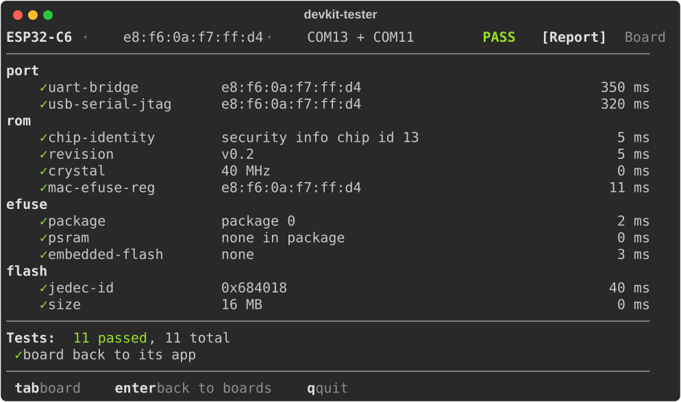

# esp32-devkit-tester — test any ESP32 dev board in seconds

**Plug in a new ESP32 development board, press a key, and get a Jest-style report**: is the
chip alive, do the UART and JTAG ports work, do the eFuses, flash and PSRAM match what the
board claims, and what exactly is on it.

> **Status:** v0.0.1 — foundation (host TUI skeleton, firmware build for ESP32, ESP32-C3,
> ESP32-C6 and ESP32-S3, CI). v0.1 (board identification) in progress. See the
> [roadmap](docs/project/ROADMAP.md).

```
 PASS  port      USB-Serial/JTAG 303A:1001 · CH343 bridge                 (40 ms)
 PASS  rom       ESP32-C6 rev v0.1 · 40 MHz crystal · sync @115200        (12 ms)
 PASS  efuse     MAC 40:4c:ca:xx:xx:xx · package QFN40                    (18 ms)
 PASS  flash     JEDEC C84017 · 8 MB                                      (25 ms)
 SKIP  psram     not present in eFuse
Tests: 4 passed, 1 skipped, 5 total
```
*(mockup — real capture coming with v0.1)*

## Supported chips

| Chip | Identify (v0.1) | On-target tests (v0.2) | JTAG (v0.3) |
|------|:---:|:---:|:---:|
| ESP32 | planned | planned | external probe |
| ESP32-C3 | planned | planned | built-in USB |
| ESP32-C5 | planned | planned | built-in USB |
| ESP32-C6 | planned | planned | built-in USB |
| ESP32-S3 | planned | planned | built-in USB |
| ESP32-P4 | planned | planned | built-in USB |
| ESP32-H2 | planned | planned | built-in USB |

## How it works

- **Host tool (Rust):** a terminal UI built with [ratatui](https://ratatui.rs) that finds the
  board's ports by USB VID:PID, talks to the chip's **ROM bootloader** through
  [espflash](https://github.com/esp-rs/espflash) and shows the results. Windows (PowerShell) first; WSL2, Linux and macOS are planned.
- **Test firmware (C, ESP-IDF):** from v0.2, a small firmware per chip runs memory, flash and
  CPU tests on the board itself and streams the results back.
- **Non-destructive by default:** v0.1 only reads. Writing the test firmware always asks first.

## Usage

The **user manual** walks through every screen with real bench screenshots, the `--no-tui` /
`--json` modes for scripts and CI, and what each result means:
[English](docs/project/MANUAL.en.md) · [Português](docs/project/MANUAL.md).



## Building from source

Windows + PowerShell (the reference platform). Full setup, including ESP-IDF v5.5.2 and known
pitfalls, in [docs/project/SETUP.md](docs/project/SETUP.md) (Portuguese).

```powershell
cargo run --manifest-path host/Cargo.toml        # host TUI (Rust stable)

. .\scripts\Enable-Idf.ps1                       # firmware: activate ESP-IDF v5.5.2
idf.py -C firmware -B firmware/build-esp32c6 -D SDKCONFIG=build-esp32c6/sdkconfig set-target esp32c6 build
```

## Related

- [esp32-logcat](https://github.com/RenatoFaraco/esp32-logcat) — persistent, `adb logcat`-style
  logging for ESP32 firmware.

## License

[MIT](LICENSE)
