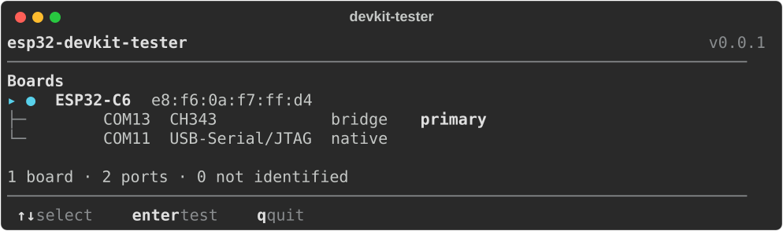
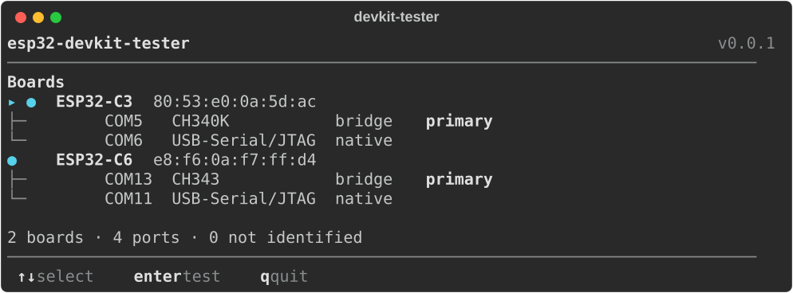
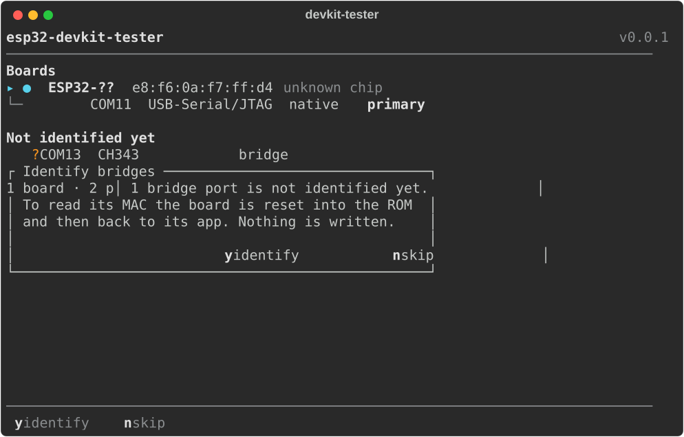
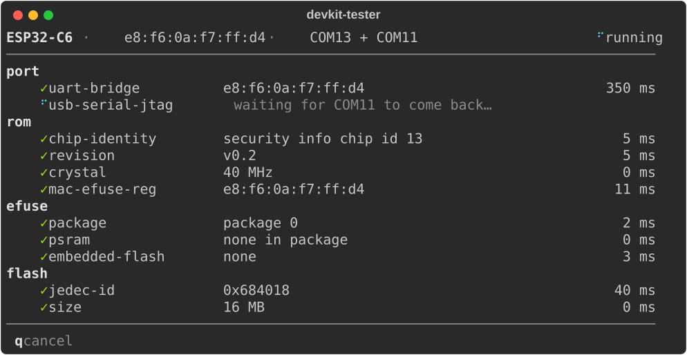
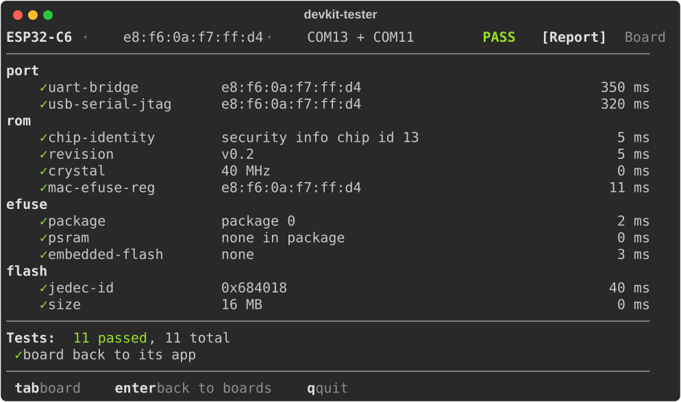
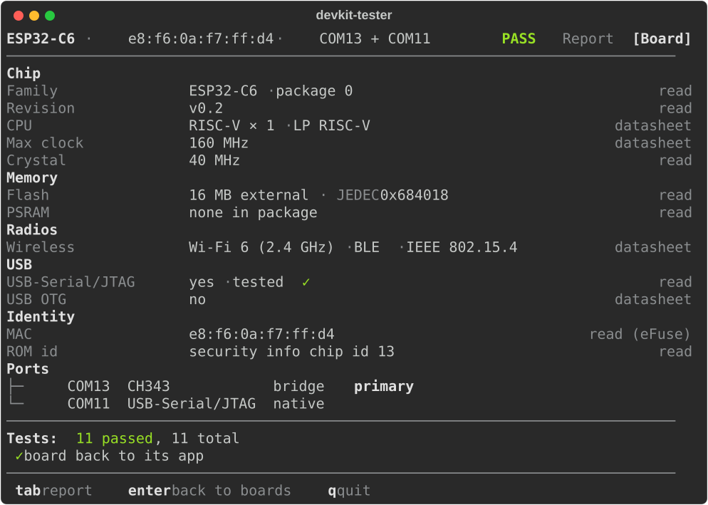
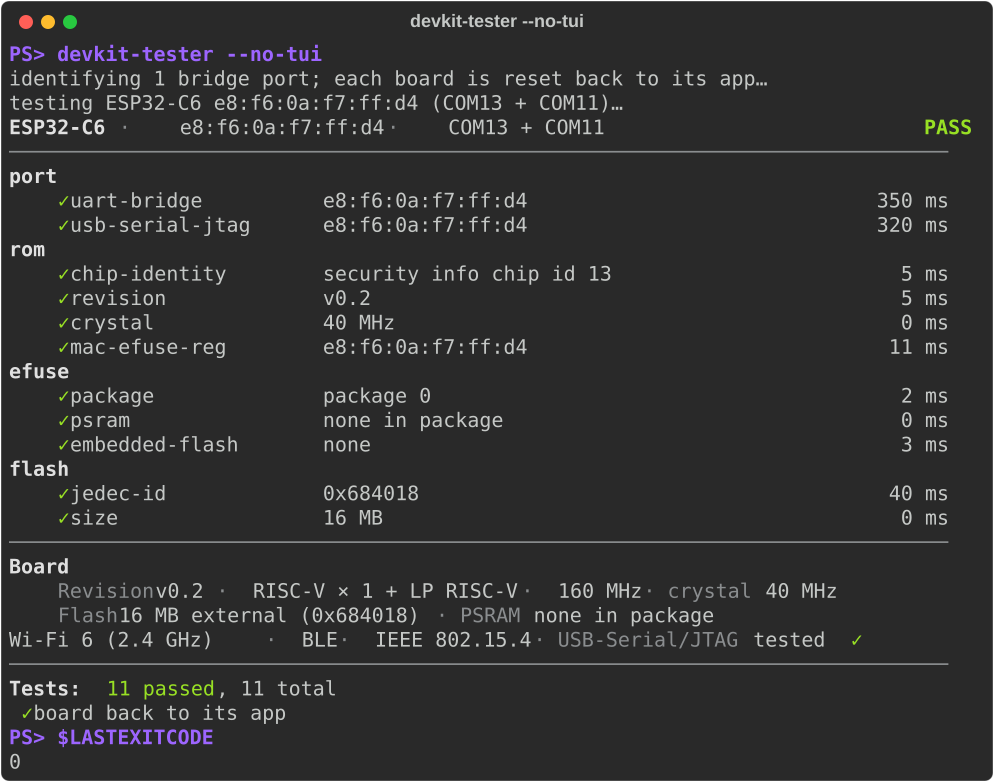
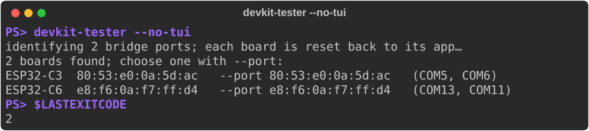

# User manual — esp32-devkit-tester

> For people who **use** the tester: plug in a freshly bought ESP32 development board, open
> `devkit-tester` and understand what it says about the board. Internals: the ADRs in
> `docs/context/decisions/`. Board facts and USB pitfalls: `docs/context/hardware.md`.

The terminal images in this manual are **real bench output**: sessions recorded with
`host/examples/record_session.rs` and drawn by the same code as the TUI and `--no-tui`
(`host/examples/manual_screenshots.rs`, see [the end of the manual](#how-the-images-were-made)).

> Versão em português: [MANUAL.md](MANUAL.md)

## Start here

With the board plugged into USB, open **PowerShell** at the repository root and type:

```powershell
cd C:\dev\esp32-devkit-tester
cargo build --release --manifest-path host/Cargo.toml
host\target\release\devkit-tester.exe
```

Press `enter`. If the *Identify bridges* box shows up, press `y`. Press `enter` again to test and
`tab` to see the board's sheet. `q` quits. **Nothing is written to the board**: at the end it
runs the firmware it already had (section 6).

## Contents

1. [From zero to the first test](#1-from-zero-to-the-first-test)
2. [Reading the screens](#2-reading-the-screens)
3. [What happens in each situation](#3-what-happens-in-each-situation)
4. [Scripts and CI](#4-scripts-and-ci)
5. [The board's ports](#5-the-boards-ports)
6. [Guarantees: the board leaves as it came](#6-guarantees-the-board-leaves-as-it-came)
7. [Troubleshooting](#7-troubleshooting)
8. [Quick reference](#8-quick-reference)

---

## 1. From zero to the first test

### 1.1 What you need

- **Windows** with PowerShell (the reference platform for v0.1; Linux and macOS come later,
  ADR-007).
- Stable **Rust** with the MSVC toolchain: `docs/project/SETUP.md`, sections 1 to 3. Testing
  boards **does not need ESP-IDF**: the tester talks to the bootloader built into the silicon.
- An ESP32 board of any supported family: ESP32, C3, C5, C6, S3, P4 (H2 once there is a board).
- A USB **data** cable (a charge-only cable enumerates nothing).

### 1.2 Build (once, and after each update)

```powershell
cd C:\dev\esp32-devkit-tester
cargo build --release --manifest-path host/Cargo.toml
```

The executable is `host\target\release\devkit-tester.exe`. Keep it in a variable so you don't
type the path (used in the rest of the manual):

```powershell
$t = "host\target\release\devkit-tester.exe"
& $t --version
```

### 1.3 Plug the board in

Many boards have **two** USB ports: a USB-serial bridge (CP210x, CH340, CH343, CH9102) and the
chip's native USB (USB-Serial/JTAG, on C3, C5, C6, S3, P4 and H2). Plug in **both** if you can:
the tester joins them into one board and tests each port. With just one, it tests what is
plugged in and says what was missing (section 5).

### 1.4 Open it

```powershell
& $t
```

The first screen lists what is connected. It refreshes by itself when you plug or unplug a
board, without opening any port.

---

## 2. Reading the screens

### 2.1 Board list



- Each **●** is a board, identified by its **factory MAC** burned into eFuse, not by the COM
  number, which changes from PC to PC.
- Under it, the tree of the board's ports:
  - **`bridge`** is the USB-serial bridge;
  - **`native`** is the chip's own USB;
  - **`primary`** is the port the suites run through: the bridge, when there is one and it
    answers; otherwise the next port that answers.
- `↑↓` picks the board and `enter` tests it.

With two boards plugged in, both show up and you pick which one to test:



### 2.2 Identifying bridges



The native port arrives with the MAC as its USB serial number, so the tester knows which board it
belongs to without opening it. The bridge carries no such information. To find out which board it
belongs to, the tester has to:
1. reset the chip into the ROM bootloader;
2. read the MAC;
3. reset it back to the board's firmware.

That's why it **asks first**. `y` identifies and `n` skips: the bridge is left out and not
touched. Meanwhile, the board known only through its native port shows as
`ESP32-??  unknown chip`. After identification, the bridge joins the right board's tree
(image 2.1).

### 2.3 Running



- Rows appear as tests finish, each with its duration on the right.
- **`waiting for COM11 to come back…`**: resetting the chip through the bridge makes the native
  USB disappear and come back (section 5). The tester waits for it by serial number, then tests
  it.
- `q` cancels: the board still gets its reset back to its firmware and the screen returns to the
  list.

### 2.4 Report



| Symbol | Meaning |
|---|---|
| green `✓` | passed |
| red `✕` | failed; the reason is below it, in gray, after `└` |
| yellow `○` | does not apply to this board (SKIP), with the reason below |
| yellow `!` | the value read differs from the capability table (finding) |

The suites:

| Suite | Checks | Through |
|---|---|---|
| `port` | each port syncs with the ROM and reads the same MAC | each port |
| `rom` | chip identity, silicon revision, crystal, MAC re-read from eFuse (`READ_REG`) | primary port |
| `efuse` | package, in-package PSRAM and flash | primary port |
| `flash` | JEDEC ID and flash size | primary port |

- At the bottom, `Tests: …` and **`✓ board back to its app`**: proof that the board got its
  final reset and is running its firmware again.
- `↑↓`, `PgUp/PgDn` and `Home/End` scroll when the report doesn't fit.

### 2.5 Board sheet (Board tab)



`tab` switches between the report and the **sheet**: what the board is. The right column says
where each value came from:
- **`read`** was read from the board just now;
- **`datasheet`** comes from the chip's capability table.

When both exist and disagree, **the value read wins**, marked with `!` and with the table value
below. This is where you check what the seller promised: silicon revision, flash, PSRAM, radios,
USB.

---

## 3. What happens in each situation

> Situations without an image are still to be recorded (issue #65). The text below is real bench
> output.

### 3.1 Original ESP32 (no USB-Serial/JTAG)

The original ESP32 has no native USB: the `usb-serial-jtag` test is a **SKIP**, not a FAIL. A
board without the feature is not faulty.

```
    ○ usb-serial-jtag
                           └ chip has no USB-Serial/JTAG; JTAG needs an
                             external probe (GPIO12-15)
```

On these boards `uart-bridge` takes ~6 s: the original ESP32 ROM doesn't know the command newer
chips use to identify themselves, and the DevKit V1 auto-reset circuit needs a few attempts.

### 3.2 S3 (or another chip) whose firmware uses USB OTG

If the flashed firmware uses **USB OTG** (TinyUSB), the native USB shows as `303A:4001`, **not**
as USB-Serial/JTAG. It is listed apart and never opened:

```
 Other ports (not tested)
   · COM14  303A:4001        Espressif USB from the app firmware (USB OTG)
```

The board's `usb-serial-jtag` is a SKIP `native USB not connected on this board`. With firmware
that doesn't use OTG (any ESP-IDF example, such as `hello_world`), the port is `303A:1001` again
and gets tested (section 5).

### 3.3 Port in use by another program

A serial monitor open on the port (esp32-logcat, idf.py monitor, PuTTY) blocks the test on that
port. The test fails with the reason, and the board is still reported back to its firmware,
because the tester never touched it through that port:

```
    ✕ usb-serial-jtag                                                   5 ms
                           └ port busy: another program (e.g. a serial
                             monitor) has it open
```

Close the other program and test again.

If only **one** of the ports is busy (esp32-logcat on the bridge, for instance), the tester uses
the other: the suites run through the port that synced, and only the busy port's test fails.
Keep in mind that **testing resets the board**: the final reset goes back to the firmware, and a
monitor open on the other port sees a restart.

### 3.4 Board unplugged mid-run

The running test becomes **FAIL** `port disconnected during…`, the following ones become
**SKIP** `not run: … failed`, and no test disappears from the report. The TUI keeps responding,
and `--no-tui` exits with code 1.

### 3.5 COM number that changes

The COM number depends on the PC and the USB socket (this bench's C3 has been COM10 and COM5).
The tester **never** uses it to decide anything: ports are identified by VID:PID, serial number
and MAC.

### 3.6 Cancelling

- **In the TUI:** `q` during a run.
- **In `--no-tui`:** `Ctrl+C`.

Either way, the open session gets its reset back to the firmware. In `--no-tui`, stdout stays
empty and the exit code is 2.

---

## 4. Scripts and CI

### 4.1 Text (`--no-tui`)

The same report, plus a compact sheet. Progress goes to **stderr** and the report to **stdout**:



- Redirected to a file or pipe, it is plain ASCII (`+ x -`, `|`) without colours.
- `NO_COLOR=1` turns colours off even on a terminal.

```powershell
& $t --no-tui > report.txt
$env:NO_COLOR = 1; & $t --no-tui; Remove-Item Env:NO_COLOR
```

### 4.2 Picking the board (`--port`)

Without `--port`, the tester runs when there is **exactly one** board. With several, it lists
them on stderr, with the `--port` value ready to copy, and exits with code 2:



`--port` takes the **port name** (`COM13`), the **USB serial number** or the **MAC**
(`e8:f6:0a:f7:ff:d4`, any case, with or without separators). It tests only that port.

### 4.3 JSON (`--json`)

One JSON line on stdout, in the format of the spec `docs/context/spec/report-json.md` (the schema
version is in `schema_version`). `--json` implies `--no-tui`.

```powershell
$r = & $t --json --port 80:53:e0:0a:5d:ac | ConvertFrom-Json
$r.summary                 # passed / failed / skipped / total
$r.board.chip              # target, name, revision
$r.tests | Where-Object state -ne 'pass'
& $t --json | Set-Content -Encoding ascii report.json   # PowerShell 5.1: save as ASCII
```

The JSON never contains the COM name (the same report must be identical on any PC).

### 4.4 Exit codes

| Code | Meaning | stdout |
|---|---|---|
| `0` | tested and nothing failed (SKIP is not a failure) | the report |
| `1` | tested and at least one test failed | the report |
| `2` | did not test: no board, several without `--port`, bad argument, WSL1, cancelled | **empty** |

```powershell
& $t --no-tui; if ($LASTEXITCODE -eq 0) { "board ok" }
```

In **cmd**: `host\target\release\devkit-tester.exe --no-tui` and `echo %ERRORLEVEL%`.

---

## 5. The board's ports

| Port | VID:PID | How the tester identifies it |
|---|---|---|
| USB-Serial/JTAG (native) | `303A:1001` | by the USB serial number, which **is** the chip's MAC; without opening the port |
| CP210x / CH340 / CH343 / CH9102 bridge | `10C4:EA60`, `1A86:…` | by opening the port: reset into the ROM, read the MAC, reset back |
| Firmware USB (OTG/TinyUSB) | `303A:4001` and other `303A:…` | not identified; listed under *Other ports* and never opened |

Three hardware facts explain what you see on screen:

- **The native port "disappears and comes back".** USB-Serial/JTAG is part of the chip. Any chip
  reset, including through the EN pin the bridge drives, drops the USB device, and Windows
  enumerates it again within 2 s. That's why the tester waits for the port to come back, looking
  for its serial number.
- **The CH340K has no serial number.** Windows makes one up (`"6"`). The tester ignores it and
  identifies the bridge by the MAC it reads.
- **OTG vs. USB-Serial/JTAG.** On the S3 (and other chips with OTG), the D+/D− pins (GPIO19/20)
  go through a selector that connects **one** of the two controllers. The reset default is
  USB-Serial/JTAG. A TinyUSB firmware switches to OTG, and the ROM's port disappears until the
  next firmware.

---

## 6. Guarantees: the board leaves as it came

v0.1 **only reads**. The tester talks to the **mask-ROM bootloader** of the chip. It comes from
the factory, cannot be erased and answers even with an empty flash.

| The tester does | Why | Stays on the board? |
|---|---|---|
| Toggles DTR/RTS (EN and GPIO0/GPIO9) | enter the bootloader and leave it | no |
| Reads registers, eFuses, flash ID | the tests | no |
| Writes SPI controller registers and flash parameters in ROM RAM | read the JEDEC ID | no: the final reset clears them |
| **Never:** writes flash, burns eFuses, loads code into RAM, changes baud | — | — |

- **At the end**, every session ends with a hard reset. The board runs the firmware it had again,
  and the report confirms it with `✓ board back to its app`.
- **The "never" is enforced in code:** a test (`host/tests/read_only.rs`) fails the build if
  anyone calls an espflash write function.
- **Details:** ADR-003 and ADR-009.

---

## 7. Troubleshooting

| Symptom | Cause | What to do |
|---|---|---|
| No board in the list | charge-only cable; bridge driver missing | another cable; install the CH34x/CP210x driver; check that the COM shows in Device Manager |
| `identification failed: timeout` on a bridge | board just plugged in, still booting; marginal auto-reset (DevKit V1) | wait 2 s and press `i`; the tester already tries twice |
| `✕ … port busy` | another program has the port open | close the serial monitor |
| `sync failed: timeout` only on the native port, every attempt | the native USB got wedged (seen on a C6 behind a hub, after another board on the same hub was touched) | unplug **both** cables of the board, wait 5 s and plug them back (issue #65) |
| The native USB shows under *Other ports* | the firmware uses USB OTG | normal; to test it, flash firmware without OTG |
| The S3 demo's serial monitor shows `SHA-256 comparison failed … Attempting to boot anyway` | the factory demo bootloader has a stale hash | not the tester: it also appears on RST; the board works |
| `WSL1 is not supported` | WSL1 has no USB devices | use Windows directly, or WSL2 with `usbipd-win` |
| `--no-tui` exits 2 with nothing on stdout | no board, or several without `--port` | read stderr: it lists the boards and the `--port` for each |

---

## 8. Quick reference

**TUI keys**

| Screen | Keys |
|---|---|
| List | `↑↓` pick · `enter` test · `i` identify bridges · `q`/`Esc` quit |
| Identify | `y` identify · `n` skip |
| Running | `↑↓ PgUp PgDn Home End` scroll · `q`/`Esc`/`Ctrl+C` cancel |
| Result | `tab` Report/Board · `↑↓ PgUp PgDn Home End` scroll · `enter` back · `q` quit |

**Options**

| Option | Does |
|---|---|
| (none) | opens the TUI |
| `--no-tui` | text report on stdout, progress on stderr |
| `--json` | JSON report (spec `report-json.md`); implies `--no-tui` |
| `--port X` | tests only port X (name, serial number or MAC); needs `--no-tui` or `--json` |
| `--help`, `--version` | help and version |

**Exit codes:** `0` ok · `1` some FAIL · `2` did not test (empty stdout).

---

## How the images were made

1. **Recording:** `host/examples/record_session.rs <name>` runs the real tester on the bench, read
   only as always. It saves to `docs/project/manual/sessions/<name>.json`:
   - the ports Windows listed;
   - the bridge identifications;
   - the report in `--json` format.
2. **Drawing:** `host/examples/manual_screenshots.rs` reads each recording and:
   - rebuilds the screens by feeding the real events through the **same** state machine and the
     **same** drawing functions as the TUI and `--no-tui`;
   - exports each screen as a terminal window in SVG to `docs/project/manual/img/`.

   Running it twice changes no file.
3. **Check:** the test `host/tests/manual_images.rs` checks that every image cited here exists and
   came from a recording.

When the output changes, record again and run the generator: the images always show what the
tester actually does.

```powershell
cargo run --manifest-path host/Cargo.toml --example record_session -- c6_both --note "C6, CH343 + native"
cargo run --manifest-path host/Cargo.toml --example manual_screenshots
```
