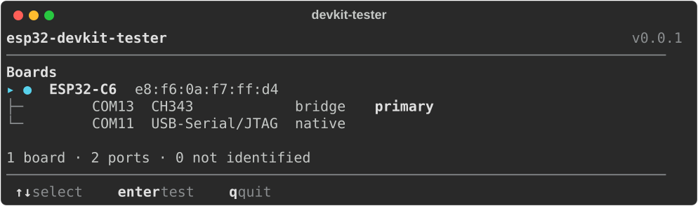
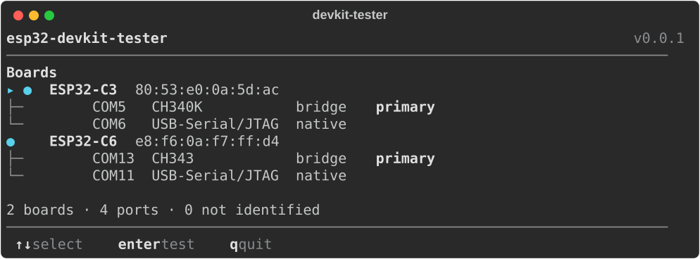
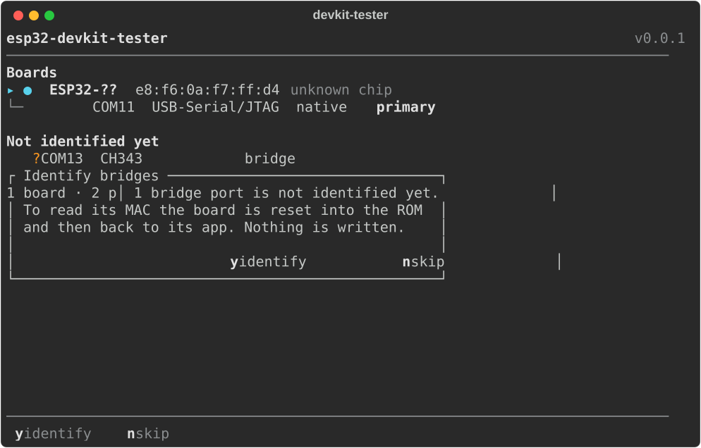
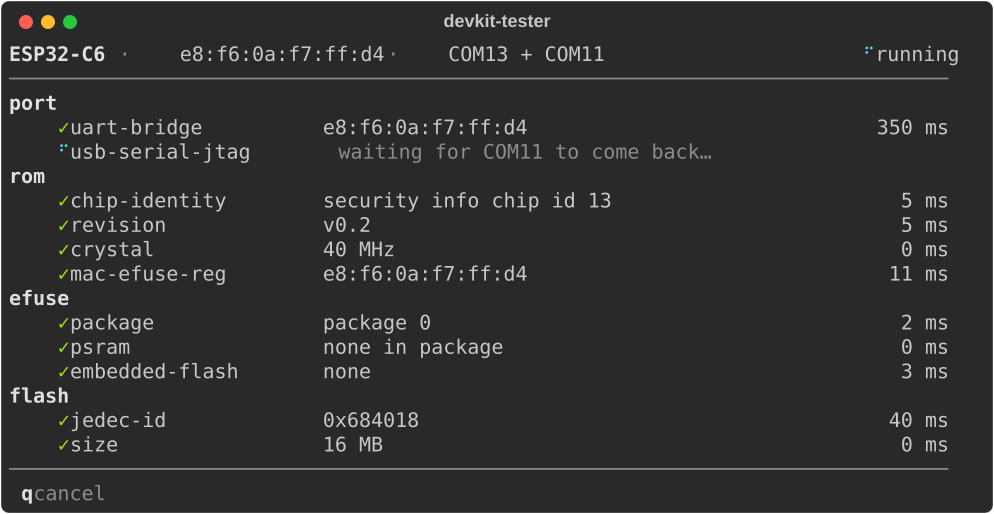
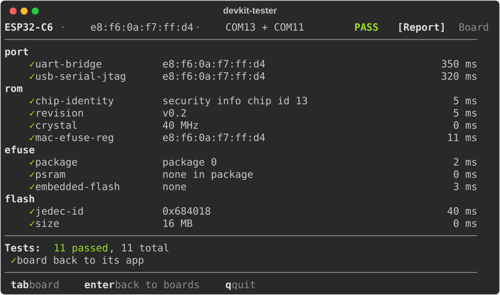
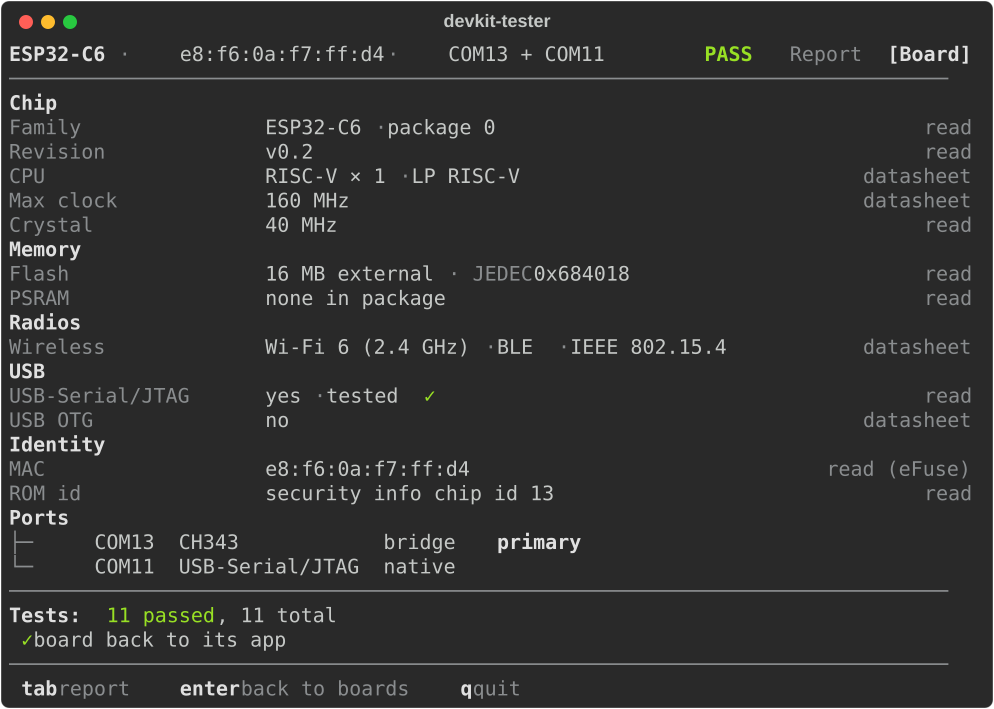
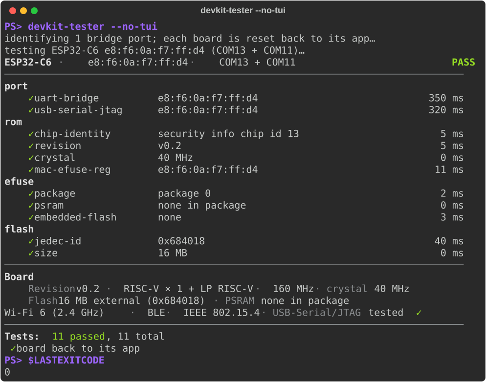
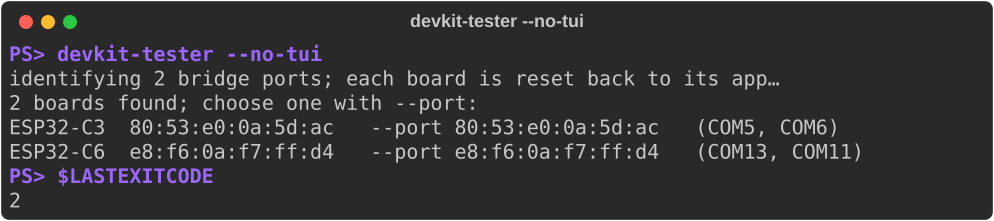

# Manual de uso — esp32-devkit-tester

> Para quem vai **usar** o testador: ligar uma placa de desenvolvimento ESP32 recém-comprada,
> abrir o `devkit-tester` e entender o que ele diz sobre ela. Por dentro: os ADRs em
> `docs/context/decisions/`. Fatos das placas e armadilhas de USB: `docs/context/hardware.md`.

As imagens do terminal deste manual são **saídas reais da bancada**: sessões gravadas com
`host/examples/record_session.rs` e desenhadas pelo mesmo código da TUI e do `--no-tui`
(`host/examples/manual_screenshots.rs`, ver [o fim do manual](#como-as-imagens-foram-feitas)).

> English version: [MANUAL.en.md](MANUAL.en.md)

## Comece aqui

Com a placa ligada no USB, abra o **PowerShell** na raiz do repositório e digite:

```powershell
cd C:\dev\esp32-devkit-tester
cargo build --release --manifest-path host/Cargo.toml
host\target\release\devkit-tester.exe
```

Aperte `enter`. Se aparecer a caixa *Identify bridges*, aperte `y`. Aperte `enter` de novo para
testar e `tab` para ver a ficha da placa. `q` sai. **Nada é gravado na placa**: no fim ela volta a
rodar o firmware que já tinha (seção 6).

## Sumário

1. [Do zero ao primeiro teste](#1-do-zero-ao-primeiro-teste)
2. [Lendo as telas](#2-lendo-as-telas)
3. [O que acontece em cada situação](#3-o-que-acontece-em-cada-situação)
4. [Modo script e CI](#4-modo-script-e-ci)
5. [As portas da placa](#5-as-portas-da-placa)
6. [Garantias: a placa sai como entrou](#6-garantias-a-placa-sai-como-entrou)
7. [Solução de problemas](#7-solução-de-problemas)
8. [Referência rápida](#8-referência-rápida)

---

## 1. Do zero ao primeiro teste

### 1.1 O que você precisa

- **Windows** com PowerShell (a plataforma de referência da v0.1; Linux e macOS vêm depois,
  ADR-007).
- **Rust** estável com o toolchain MSVC: `docs/project/SETUP.md`, seções 1 a 3. Para testar
  placas **não é preciso ESP-IDF**: o testador conversa com o bootloader que vem gravado no
  silício.
- Uma placa ESP32 de qualquer família suportada: ESP32, C3, C5, C6, S3, P4 (H2 quando houver
  placa).
- Um cabo USB **de dados** (cabo só de carga não enumera nada).

### 1.2 Compilar (uma vez, e a cada atualização)

```powershell
cd C:\dev\esp32-devkit-tester
cargo build --release --manifest-path host/Cargo.toml
```

O executável fica em `host\target\release\devkit-tester.exe`. Para não digitar o caminho,
guarde-o numa variável (vale para o resto do manual):

```powershell
$t = "host\target\release\devkit-tester.exe"
& $t --version
```

### 1.3 Ligar a placa

Muitas placas têm **duas** USB: uma ponte USB-serial (CP210x, CH340, CH343, CH9102) e a USB
nativa do chip (USB-Serial/JTAG, nos C3, C5, C6, S3, P4 e H2). Ligue **as duas** se puder: o
testador junta as duas numa placa só e testa cada porta. Com uma só, ele testa o que estiver
ligado e diz o que faltou (seção 5).

### 1.4 Abrir

```powershell
& $t
```

A tela inicial lista o que está ligado. Ela se atualiza sozinha quando você pluga ou despluga
uma placa, sem abrir nenhuma porta.

---

## 2. Lendo as telas

### 2.1 Lista de placas



- Cada **●** é uma placa, identificada pelo **MAC de fábrica** gravado em eFuse, e não pelo
  número da COM, que muda de PC para PC.
- Embaixo, a árvore com as portas da placa:
  - **`bridge`** é a ponte USB-serial;
  - **`native`** é a USB do próprio chip;
  - **`primary`** é a porta pela qual as suítes rodam: a ponte, quando existe e responde; senão,
    a próxima porta que responder.
- `↑↓` escolhe a placa e `enter` testa.

Com duas placas ligadas, as duas aparecem e você escolhe qual testar:



### 2.2 Identificar pontes



A porta nativa já chega com o MAC no número de série USB, então o testador sabe de que placa
ela é sem abri-la. A ponte não tem essa informação. Para descobrir de que placa ela é, o testador
precisa:
1. resetar o chip para o bootloader da ROM;
2. ler o MAC;
3. resetar de volta para o firmware da placa.

Por isso ele **pergunta antes**. `y` identifica e `n` pula: a ponte fica de fora e não é tocada.
Enquanto isso, a placa só com a porta nativa aparece como `ESP32-??  unknown chip`. Depois da
identificação, a ponte entra na árvore da placa certa (imagem 2.1).

### 2.3 Executando



- As linhas aparecem conforme os testes terminam, cada uma com a duração à direita.
- **`waiting for COM11 to come back…`**: ao resetar o chip pela ponte, a USB nativa some e volta
  (seção 5). O testador espera ela reaparecer, procurando pelo número de série, e então a testa.
- `q` cancela: a placa recebe o reset de volta ao firmware e a tela volta à lista.

### 2.4 Relatório



| Símbolo | Significa |
|---|---|
| `✓` verde | passou |
| `✕` vermelho | falhou; o motivo aparece embaixo, em cinza, com `└` |
| `○` amarelo | não se aplica a esta placa (SKIP), com o motivo embaixo |
| `!` amarelo | o valor lido diverge da tabela de capacidades (achado) |

As suítes:

| Suíte | Testa | Por onde |
|---|---|---|
| `port` | cada porta sincroniza com a ROM e lê o mesmo MAC | cada porta |
| `rom` | identidade do chip, revisão do silício, cristal, MAC relido do eFuse (`READ_REG`) | porta primária |
| `efuse` | encapsulamento, PSRAM e flash dentro do chip | porta primária |
| `flash` | ID JEDEC e tamanho da flash | porta primária |

- No rodapé, `Tests: …` e **`✓ board back to its app`**: a confirmação de que a placa recebeu o
  reset final e voltou ao firmware dela.
- `↑↓`, `PgUp/PgDn` e `Home/End` rolam quando o relatório não cabe na tela.

### 2.5 Ficha da placa (aba Board)



`tab` alterna entre o relatório e a **ficha**: o que a placa é. A coluna da direita diz de onde
veio cada valor:
- **`read`** foi lido da placa agora;
- **`datasheet`** vem da tabela de capacidades do chip.

Quando os dois existem e divergem, **o lido vence**, marcado com `!` e com o valor da tabela
embaixo. É aqui que você confere o que o vendedor prometeu: revisão do silício, flash, PSRAM,
rádios, USB.

---

## 3. O que acontece em cada situação

> As situações sem imagem ainda serão gravadas (issue #65). Os textos abaixo são saídas reais da
> bancada.

### 3.1 ESP32 original (sem USB-Serial/JTAG)

O ESP32 original não tem USB nativa: o teste `usb-serial-jtag` sai como **SKIP**, não FAIL. Placa
que não tem o recurso não está com defeito.

```
    ○ usb-serial-jtag
                           └ chip has no USB-Serial/JTAG; JTAG needs an
                             external probe (GPIO12-15)
```

O `uart-bridge` dessas placas leva ~6 s: o ROM do ESP32 original não conhece o comando que os
chips novos usam para se identificar, e o circuito de auto-reset do DevKit V1 pede algumas
tentativas.

### 3.2 S3 (ou outro chip) com firmware usando USB OTG

Se o firmware gravado usa o **USB OTG** (TinyUSB), a USB nativa aparece como `303A:4001` e
**não** como USB-Serial/JTAG. Ela é listada à parte e nunca é aberta:

```
 Other ports (not tested)
   · COM14  303A:4001        Espressif USB from the app firmware (USB OTG)
```

O `usb-serial-jtag` da placa sai como SKIP `native USB not connected on this board`. Com um
firmware que não use o OTG (qualquer exemplo do ESP-IDF, como o `hello_world`), a porta volta a
ser `303A:1001` e é testada (seção 5).

### 3.3 Porta ocupada por outro programa

Um monitor serial aberto na porta (esp32-logcat, idf.py monitor, PuTTY) impede o teste naquela
porta. O teste falha com o motivo, e a placa continua marcada como de volta ao firmware, porque
o testador nem chegou a tocá-la por ali:

```
    ✕ usb-serial-jtag                                                   5 ms
                           └ port busy: another program (e.g. a serial
                             monitor) has it open
```

Feche o outro programa e teste de novo.

Se só **uma** das portas estiver ocupada (o logcat na ponte, por exemplo), o testador usa a
outra: as suítes rodam pela porta que sincronizou, e só o teste da porta ocupada falha. Lembre que
**testar reinicia a placa**: o reset final volta para o firmware, e um monitor aberto na outra
porta vê um restart.

### 3.4 Placa desplugada no meio do teste

O teste em andamento vira **FAIL** `port disconnected during…`, os seguintes viram **SKIP**
`not run: … failed`, e nenhum teste some do relatório. A TUI continua respondendo, e o `--no-tui`
sai com código 1.

### 3.5 COM que muda de número

O número da COM depende do PC e da porta USB (a C3 desta bancada já foi COM10 e COM5). O
testador **nunca** usa o número para decidir nada: identifica as portas por VID:PID, pelo número
de série e pelo MAC.

### 3.6 Cancelar

- **Na TUI:** `q` durante o teste.
- **No `--no-tui`:** `Ctrl+C`.

Nos dois casos, a sessão aberta recebe o reset de volta ao firmware. No `--no-tui`, a saída fica
vazia e o código de saída é 2.

---

## 4. Modo script e CI

### 4.1 Texto (`--no-tui`)

O mesmo relatório, mais uma ficha compacta. O progresso vai para o **stderr** e o relatório para
o **stdout**:



- Redirecionado para arquivo ou pipe, sai em ASCII puro (`+ x -`, `|`) e sem cores.
- `NO_COLOR=1` desliga as cores mesmo no terminal.

```powershell
& $t --no-tui > relatorio.txt
$env:NO_COLOR = 1; & $t --no-tui; Remove-Item Env:NO_COLOR
```

### 4.2 Escolher a placa (`--port`)

Sem `--port`, o testador roda se houver **exatamente uma** placa. Com várias, ele lista as placas
no stderr, com o `--port` pronto para copiar, e sai com código 2:



`--port` aceita o **nome da porta** (`COM13`), o **número de série USB** ou o **MAC**
(`e8:f6:0a:f7:ff:d4`, em qualquer caixa, com ou sem separador). Ele testa só aquela porta.

### 4.3 JSON (`--json`)

Uma linha JSON no stdout, no formato da spec `docs/context/spec/report-json.md` (versão do
esquema no campo `schema_version`). `--json` já implica `--no-tui`.

```powershell
$r = & $t --json --port 80:53:e0:0a:5d:ac | ConvertFrom-Json
$r.summary                 # passed / failed / skipped / total
$r.board.chip              # target, name, revision
$r.tests | Where-Object state -ne 'pass'
& $t --json | Set-Content -Encoding ascii report.json   # PowerShell 5.1: grave em ASCII
```

O JSON nunca traz o nome da COM (o mesmo relatório tem de ser igual em qualquer PC).

### 4.4 Códigos de saída

| Código | Significa | stdout |
|---|---|---|
| `0` | testou e nada falhou (SKIP não é falha) | o relatório |
| `1` | testou e ao menos um teste falhou | o relatório |
| `2` | não testou: nenhuma placa, várias sem `--port`, argumento inválido, WSL1, cancelado | **vazio** |

```powershell
& $t --no-tui; if ($LASTEXITCODE -eq 0) { "placa ok" }
```

No **cmd**: `host\target\release\devkit-tester.exe --no-tui` e `echo %ERRORLEVEL%`.

---

## 5. As portas da placa

| Porta | VID:PID | Como o testador a identifica |
|---|---|---|
| USB-Serial/JTAG (nativa) | `303A:1001` | pelo número de série USB, que **é** o MAC do chip; sem abrir a porta |
| Ponte CP210x / CH340 / CH343 / CH9102 | `10C4:EA60`, `1A86:…` | abrindo a porta: reset para a ROM, lê o MAC, reset de volta |
| USB do firmware (OTG/TinyUSB) | `303A:4001` e outros `303A:…` | não identifica; lista em *Other ports* e nunca abre |

Três coisas do hardware explicam o que você vê na tela:

- **A nativa "some e volta".** O USB-Serial/JTAG faz parte do chip. Qualquer reset do chip,
  inclusive pelo pino EN que a ponte aciona, derruba o dispositivo USB, e o Windows o enumera de
  novo em menos de 2 s. Por isso o testador espera a porta voltar, procurando pelo número de
  série.
- **CH340K não tem número de série.** O Windows inventa um (`"6"`). O testador o descarta e
  identifica essa ponte pelo MAC lido.
- **OTG × USB-Serial/JTAG.** No S3 (e em outros chips com OTG), os pinos D+/D− (GPIO19/20) passam
  por um seletor que liga **um** dos dois controladores. O padrão no reset é o USB-Serial/JTAG. Um
  firmware com TinyUSB troca para o OTG, e aí a porta da ROM some até o próximo firmware.

---

## 6. Garantias: a placa sai como entrou

A v0.1 **só lê**. O testador fala com o **bootloader gravado em máscara na ROM** do chip. Ele vem
de fábrica, não pode ser apagado e responde mesmo com a flash vazia.

| O testador faz | Por quê | Fica na placa? |
|---|---|---|
| Mexe nas linhas DTR/RTS (EN e GPIO0/GPIO9) | entrar no bootloader e voltar | não |
| Lê registradores, eFuses, ID da flash | os testes | não |
| Escreve registradores do controlador SPI e parâmetros da flash na RAM do ROM | ler o ID JEDEC | não: o reset final apaga tudo |
| **Nunca:** grava flash, grava eFuse, carrega código na RAM, muda o baud | — | — |

- **No fim**, cada sessão termina com um hard reset. A placa volta a rodar o firmware que tinha,
  e o relatório confirma com `✓ board back to its app`.
- **O "nunca" é garantido no código:** um teste (`host/tests/read_only.rs`) falha o build se
  alguém chamar uma função de escrita do espflash.
- **Detalhes:** ADR-003 e ADR-009.

---

## 7. Solução de problemas

| Sintoma | Causa | O que fazer |
|---|---|---|
| Nenhuma placa na lista | cabo só de carga; driver da ponte ausente | outro cabo; instale o driver CH34x/CP210x; veja se a COM aparece no Gerenciador de Dispositivos |
| `identification failed: timeout` numa ponte | placa recém-plugada ainda bootando; auto-reset marginal (DevKit V1) | espere 2 s e aperte `i`; o testador já tenta duas vezes |
| `✕ … port busy` | outro programa com a porta aberta | feche o monitor serial |
| `sync failed: timeout` só na porta nativa, em toda tentativa | a USB nativa travou (visto na C6 atrás de hub, depois de mexer em outra placa no mesmo hub) | desplugue os **dois** cabos da placa, espere 5 s e plugue de novo (issue #65) |
| A USB nativa aparece em *Other ports* | o firmware usa USB OTG | normal; para testá-la, grave um firmware sem OTG |
| No monitor serial do S3 de demonstração: `SHA-256 comparison failed … Attempting to boot anyway` | o bootloader da demo de fábrica tem o hash desatualizado | não é o testador: aparece também apertando RST; a placa funciona |
| `WSL1 is not supported` | WSL1 não tem dispositivos USB | use o Windows direto, ou o WSL2 com `usbipd-win` |
| `--no-tui` sai com 2 e nada no stdout | nenhuma placa, ou várias sem `--port` | leia o stderr: ele lista as placas e o `--port` de cada uma |

---

## 8. Referência rápida

**Teclas da TUI**

| Tela | Teclas |
|---|---|
| Lista | `↑↓` escolhe · `enter` testa · `i` identifica pontes · `q`/`Esc` sai |
| Identificar | `y` identifica · `n` pula |
| Executando | `↑↓ PgUp PgDn Home End` rolam · `q`/`Esc`/`Ctrl+C` cancela |
| Resultado | `tab` Report/Board · `↑↓ PgUp PgDn Home End` rolam · `enter` volta · `q` sai |

**Opções**

| Opção | Faz |
|---|---|
| (nenhuma) | abre a TUI |
| `--no-tui` | relatório em texto no stdout, progresso no stderr |
| `--json` | relatório JSON (spec `report-json.md`); implica `--no-tui` |
| `--port X` | testa só a porta X (nome, número de série ou MAC); exige `--no-tui` ou `--json` |
| `--help`, `--version` | ajuda e versão |

**Códigos de saída:** `0` ok · `1` algum FAIL · `2` não testou (stdout vazio).

---

## Como as imagens foram feitas

1. **Gravação:** `host/examples/record_session.rs <nome>` roda o testador de verdade na bancada,
   só lendo, como sempre. Ele grava em `docs/project/manual/sessions/<nome>.json`:
   - as portas que o Windows listou;
   - as identificações das pontes;
   - o relatório no formato do `--json`.
2. **Desenho:** `host/examples/manual_screenshots.rs` lê cada gravação e:
   - reconstrói as telas passando os eventos reais pela **mesma** máquina de estados e pelas
     **mesmas** funções de desenho da TUI e do `--no-tui`;
   - exporta cada tela como janela de terminal em SVG para `docs/project/manual/img/`.

   Rodar duas vezes não muda nenhum arquivo.
3. **Garantia:** o teste `host/tests/manual_images.rs` confere que toda imagem citada aqui existe
   e veio de uma gravação.

Quando a saída mudar, grave de novo e rode o gerador: as imagens sempre mostram o que o testador
realmente faz.

```powershell
cargo run --manifest-path host/Cargo.toml --example record_session -- c6_both --note "C6, CH343 + native"
cargo run --manifest-path host/Cargo.toml --example manual_screenshots
```
